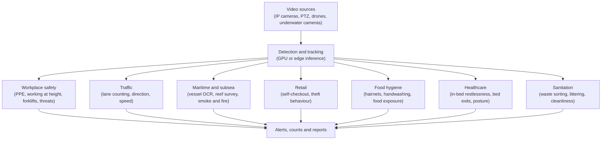

# Applied Computer Vision Portfolio

I build computer vision analytics: systems that watch video and turn it into counts, alerts and reports. This repository is the guide to my work across seven areas. Each area has its own repository with example code and an explanation of the approach.

Everything here describes ideas and methods. The code in these repositories is my own implementation.

---

## How a typical analytic works

---

## Repositories

| Repository | What it covers | Main techniques |
| :--- | :--- | :--- |
| [workplace-safety-vision](https://github.com/mh-masum6875/workplace-safety-vision) | PPE compliance, fall detection, loitering, crowd density and threat detection | ONNX Runtime GPU, YOLOv8, spatial overlap logic, SORT tracking |
| [traffic-flow-analytics](https://github.com/mh-masum6875/traffic-flow-analytics) | Multi-lane vehicle counting and directional flow | YOLOv8 and YOLO11, DeepSORT, Excel reporting, lighting adaptation |
| [maritime-subsea-vision](https://github.com/mh-masum6875/maritime-subsea-vision) | Vessel identification and hull number OCR, subsea ecological survey, smoke and fire monitoring | PyTorch, YOLOE, EasyOCR, CLAHE |
| [retail-loss-prevention-vision](https://github.com/mh-masum6875/retail-loss-prevention-vision) | Self-checkout checks, shoplifting behaviour, unauthorised photography | Pose estimation, hand and object interaction, transformer-based action modelling |
| [food-hygiene-vision](https://github.com/mh-masum6875/food-hygiene-vision) | Hairnet and headwear checks, handwashing timing, uncovered food | Open-vocabulary YOLOE, time-based tracking |
| [patient-monitoring-vision](https://github.com/mh-masum6875/patient-monitoring-vision) | In-bed restlessness, bed-exit falls, sitting posture | Motion and bounding-box geometry |
| [waste-cleanliness-vision](https://github.com/mh-masum6875/waste-cleanliness-vision) | Waste sorting and weight estimation, littering, spitting, surface cleanliness | Background subtraction, volume-to-weight scaling, hand and face geometry |

---

## What I have built

More than 80 analytics so far, grouped by area.

### 1. Workplace safety
- **PPE and worker compliance:** helmets, caps, face masks, ID cards, uniforms and worker presence at a station.
- **Machinery and danger zones:** working at height, people inside a crane's working area, people too close to forklifts, and driver fatigue.
- **Security:** perimeter intrusion, wall climbing, camera tampering, object throwing, and fights or crowd unrest.
- **Crowd and access:** line-crossing counts, congestion heatmaps, and blocked gates or exits.

### 2. Traffic
- Multi-lane directional counting, wrong-way detection, speed estimation, following distance, truck loading and unloading time, and vehicle theft.

### 3. Retail
- **Self-checkout:** flags items that reach the bagging area without being scanned.
- **Theft behaviour:** recognises the sequence of reaching for a shelf, taking an item and concealing it.
- **Privacy:** spots unauthorised photography with phones and tracks group footfall.

### 4. Food hygiene
- Hairnet and headwear checks, handwashing duration at the basin, uncovered food left out, cleaning activity on floors, and conveyor counting in food processing.

### 5. Healthcare
- In-bed restlessness, bed exits and falls, and desk posture.

### 6. Sanitation and cleanliness
- Waste sorting with weight estimation, public littering and spitting, and surface dust.

### 7. Maritime and subsea
- Vessel type recognition and hull number OCR, subsea surveys of fish, plants, coral and debris (one example run logged 91,120 detections), and smoke and fire monitoring on PTZ streams.

---

## How I approach a new analytic

1. **Understand the scene.** What event matters, and what counts as a false alarm?
2. **Calibrate.** Camera angle, zones of interest and real-world scale.
3. **Collect and label.** Choose between an open-vocabulary model and a trained detector.
4. **Tune and optimise.** Thresholds, confirmation over several frames, and speed (ONNX, TensorRT).
5. **Connect.** Alerts, counts, dashboards and reports.
6. **Validate and hand over.** Check results on real footage and write down the limits.

---

## Get in touch

I'm open to roles, collaborations and pilot projects in computer vision.

- Website: [mh-masum6875.github.io](https://mh-masum6875.github.io)
- LinkedIn: [linkedin.com/in/mhmasum6875](https://www.linkedin.com/in/mhmasum6875)
- Email: [mhmasum6875@gmail.com](mailto:mhmasum6875@gmail.com)

## License

MIT License.
