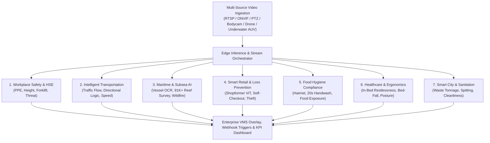

# 🏢 Enterprise Computer Vision Solutions: Applied AI Architecture & Master Capabilities

An enterprise portfolio showcasing **80+ production computer vision analytics**, multi-modal architectures, and commercial deployment frameworks spanning Industrial HSE, Smart Cities, Retail Loss Prevention, Food Safety, Healthcare, Intelligent Transportation, and Subsea Marine Analytics.

---

## 🏛️ End-to-End Enterprise Vision Architecture

---

## 📂 Core Specialized Repositories

| Repository | Domain | Core Models & Technologies |
| :--- | :--- | :--- |
| **[workplace-safety-edge-vision](https://github.com/mh-masum6875/workplace-safety-edge-vision)** | Industrial HSE, PPE Compliance & Physical Security | ONNX Runtime GPU, YOLOv8/v7, Spatial IoU, SORT |
| **[intelligent-traffic-flow-analytics](https://github.com/mh-masum6875/intelligent-traffic-flow-analytics)** | Multi-Lane Junction Counting & Directional Flow State Machine | YOLOv8/v11, DeepSORT, OpenPyXL, Dynamic Thresholds |
| **[maritime-underwater-vision-ai](https://github.com/mh-masum6875/maritime-underwater-vision-ai)** | Maritime Surveillance, Carrier OCR & Subsea Ecological Census | PyTorch, YOLOE, EasyOCR, CLAHE, CUDA 12.1 |
| **[smart-retail-loss-prevention-ai](https://github.com/mh-masum6875/smart-retail-loss-prevention-ai)** | Retail Loss Prevention, Self-Checkout Scanning & Action Recognition | Vision Transformer (ViT), Shopformer, Faster R-CNN, YOLO-Pose |
| **[food-hygiene-compliance-vision-ai](https://github.com/mh-masum6875/food-hygiene-compliance-vision-ai)** | Commercial Kitchen HACCP Compliance & Hygiene Auditing | Custom Hairnet Net, Time-decay Tracking, Open-Vocabulary YOLOE |
| **[healthcare-patient-monitoring-ergonomics](https://github.com/mh-masum6875/healthcare-patient-monitoring-ergonomics)** | Non-Invasive Clinical In-Bed Care & Workplace Posture | Centroid Displacement Kinetics, BBox Aspect Ratio Inversion |
| **[smart-city-waste-cleanliness-analytics](https://github.com/mh-masum6875/smart-city-waste-cleanliness-analytics)** | Smart Sanitation, Conveyor Waste Tonnage & Public Cleanliness | Background Subtraction, Volume-to-Mass Scaling, Hand-Face Vectors |

---

## 📊 Master Production Analytics & Capabilities Matrix (80+ Systems)

### 1. Industrial Health, Safety & Environment (HSE)
- **PPE & Worker Compliance**: Hardhat & Helmet attribution, Cap detection, Face mask monitoring, ID badge & lanyard verification, High-vis uniform compliance, Worker availability & station presence.
- **Machinery & Danger Zones**: Working at heights (ladder/harness validation), Crane operational zone breaches, Forklift-pedestrian proximity alerts, Worker fatigue & drowsiness timeout.
- **Physical Security & Threat Interception**: Perimeter intrusion & wall climbing, Camera tampering (spray, cover, blind), Projectile & stone throwing, Violence & physical altercations, Self-harm & hanging anomaly alerting.
- **Crowd & Access Dynamics**: Bi-directional gate line counting, Crowd congestion heatmaps, Emergency exit & gate obstruction alerts.

### 2. Intelligent Transportation Systems (ITS)
- **Flow & Violation**: Multi-lane directional state machine (AB, BA, CA, CD, DB, DC), One-way wrong-way transit detection, Perspective-calibrated velocity calculation, Inter-vehicle tailgating distance, Logistics loading dock turnaround duration, Motorcycle & bicycle theft detection.

### 3. Smart Retail & Loss Prevention
- **Self-Checkout Verification**: Multi-model fusion (YOLOE + Faster R-CNN hand-object interaction) catching items moved to bagging zones without entering scanning sequences ($0.3\\text{s}$ line threshold).
- **Temporal Action Recognition (`Shopformer`)**: Vision Transformer (ViT) with GCAE tokenization tracking shelf reach $\rightarrow$ object grab $\rightarrow$ pocket concealment.
- **Security & Privacy**: Unauthorized smartphone photography detection (50°–150° phone orientation angle), Purse snatching, Customer group footfall attribution.

### 4. Food Safety & Kitchen Hygiene (HACCP)
- **Headwear Compliance**: Hairnet and kitchen headwear verification with upper-torso spatial containment.
- **Hand Hygiene Protocol**: Basin zone tracking enforcing the mandatory 20-second handwashing duration.
- **Food Exposure Monitoring**: Time-decay detection of uncovered food items left on counters (>30s alert).
- **Facility Sanitation**: Multi-prompt cleaning tool (broom, mop, scrub) floor interaction detection, Poultry processing conveyor counting.

### 5. Healthcare & Patient Care
- **In-Bed Restlessness & Agitation**: Centroid displacement tracking distinguishing active agitation from peaceful sleep.
- **Bed-Exit Fall Prevention**: Aspect-ratio collapse ($\\frac{W}{H} > 1.5$) detecting unassisted bed exit and falls.
- **Ergonomics**: Office desk sitting posture monitoring and slouching alerts.

### 6. Smart City Sanitation & Cleanliness
- **Recycling & Waste Sorting**: Multi-class conveyor waste sorting with geometric volume-to-mass approximation.
- **Public Sanitation**: Spitting (Pan/Ghutka) detection on public transit walls, Street littering detection, Surface dust accumulation auditing.

### 7. Maritime & Subsea Ecological Intelligence
- **Vessel Awareness & Carrier OCR**: 8-class vessel identification, container shipping line registry recognition (Evergreen, Maersk, COSCO, Hapag-Lloyd, etc.).
- **Subsea Ecological Census**: Validated on **91,120 logged detections** quantifying marine fauna, aquatic flora, coral reefs, and ocean debris.
- **Wildfire & Smoke Surveillance**: Continuous PTZ stream inference ($\ge 80\%$ TPR) with optical glare filtering.

---

## 🚀 Commercial Pilot Implementation Framework

Our standardized 6-week commercial pilot deployment roadmap:

| Phase | Duration | Scope & Milestones | Deliverables |
| :--- | :--- | :--- | :--- |
| **Week 1** | Requirement & Feed Ingestion | Site audit, camera field-of-view calibration, RTSP ingestion setup | Camera calibration spec & sample ingestion |
| **Week 2** | Data Annotation & Baseline | Domain-specific annotation, baseline fine-tuning | Annotated dataset & model baseline report |
| **Week 3-4**| Model Optimization & Edge Pipeline | ONNX conversion, spatial IoU attribution, false-positive tuning | Optimized edge pipeline ($<20\\text{ms}$ latency) |
| **Week 5** | Dashboard & Alert Integration | Webhook triggers, live compliance HUD, interval logging | Integrated VMS overlay & alert notifications |
| **Week 6** | Audit, Validation & Handover | Accuracy benchmark verification, operator training, handover | Final validation report & documentation |

---

## 📬 Contact & Collaboration
For inquiries regarding enterprise deployments, pilot implementations, or custom computer vision architectures:
- **GitHub**: [@mh-masum6875](https://github.com/mh-masum6875)

---
## 📄 License
This project is licensed under the MIT License.
