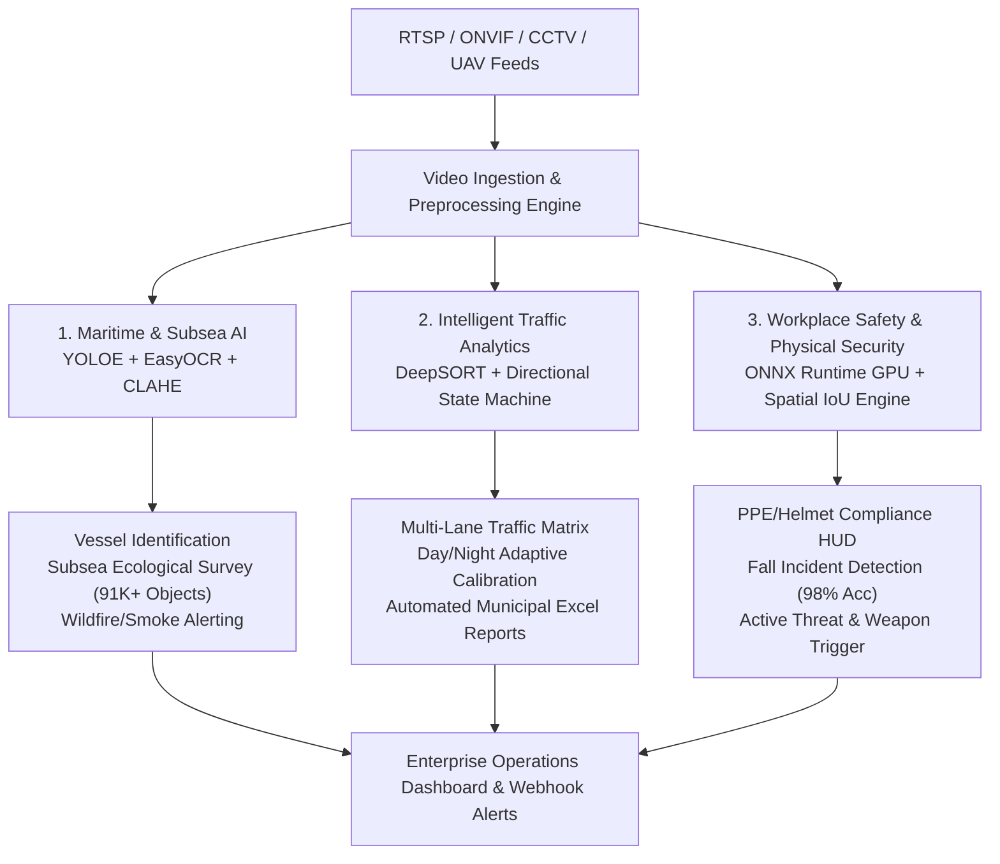

# 🏢 Enterprise Computer Vision Solutions: Applied AI Architecture & Capabilities

An executive portfolio showcasing end-to-end computer vision systems, deployment pipelines, and commercial pilot architectures spanning Maritime Intelligence, Intelligent Transportation, and Workplace Safety.

---

## 🏛️ Solution Architecture Overview

---

## 📂 Core Open-Source Repositories

### 1. [Maritime & Subsea Vision AI](https://github.com/mh-masum6875/maritime-underwater-vision-ai)
- **Focus**: UAV/USV vessel classification, commercial carrier OCR (Hapag-Lloyd, Maersk, COSCO), subsea ecological analytics (91,120+ detections logged), and smoke/fire surveillance.
- **Tech Stack**: PyTorch, CUDA 12.1, Ultralytics YOLOE, EasyOCR, CLAHE.

### 2. [Intelligent Traffic Flow Analytics](https://github.com/mh-masum6875/intelligent-traffic-flow-analytics)
- **Focus**: Multi-lane junction tracking, 6-line trajectory state machine (AB, BA, CA, CD, etc.), dynamic day/night threshold adaptation, and automated interval Excel exports.
- **Tech Stack**: YOLOv8, DeepSORT, OpenCV, OpenPyXL.

### 3. [Workplace Safety & Edge Vision](https://github.com/mh-masum6875/workplace-safety-edge-vision)
- **Focus**: Real-time worker PPE & helmet spatial attribution, 98% accuracy human fall detection, active weapon detection, and loitering/crowd analytics.
- **Tech Stack**: ONNX Runtime GPU, YOLOv7/v8, OpenCV, SORT.

---

## 🚀 Commercial Pilot Implementation Framework

Our standardized 6-week commercial pilot deployment roadmap:

| Phase | Duration | Scope & Milestones | Deliverables |
| :--- | :--- | :--- | :--- |
| **Week 1** | Requirement & Feed Ingestion | Site audit, camera field-of-view calibration, RTSP ingestion setup | Camera calibration spec & sample ingestion |
| **Week 2** | Data Annotation & Baseline | Domain-specific annotation, baseline fine-tuning | Annotated dataset & model baseline report |
| **Week 3-4**| Model Optimization & Edge Pipeline | ONNX conversion, spatial IoU attribution, false-positive tuning | Optimized edge pipeline ($<20\text{ms}$ latency) |
| **Week 5** | Dashboard & Alert Integration | Webhook triggers, live compliance HUD, interval logging | Integrated VMS overlay & alert notifications |
| **Week 6** | Audit, Validation & Handover | Accuracy benchmark verification, operator training, handover | Final validation report & documentation |

---

## 📬 Contact & Collaboration
For inquiries regarding enterprise deployments, pilot implementations, or custom computer vision architectures:
- **GitHub**: [@mh-masum6875](https://github.com/mh-masum6875)

---
## 📄 License
This project is licensed under the MIT License.
